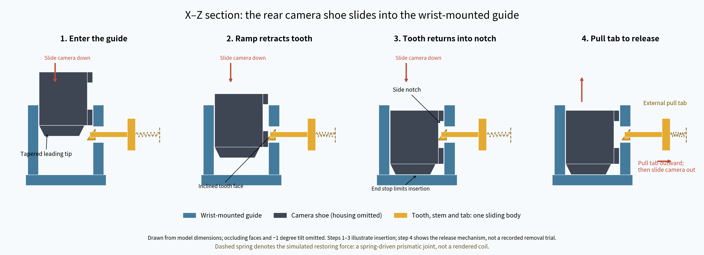
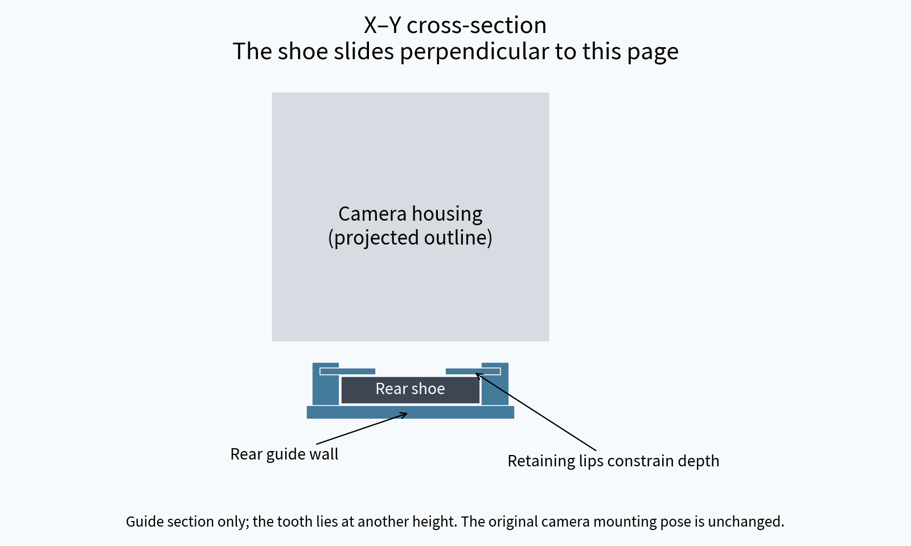

# Reattach your detached wrist camera

A live left-wrist camera has come loose and rests on the table. The robot must restore its own sensing configuration: retrieve the camera, insert its shoe into the original wrist mount, secure it, and release it. Both arms may move to facilitate installation. Returning either arm to a particular posture is not required.

## How the camera mount engages

The tapered rear shoe slides along the wrist-mounted guide. Contact with the inclined tooth retracts the spring-loaded slider; when the shoe notch reaches it, the tooth returns into the notch. The guide lips constrain depth and the end stop limits insertion. An external pull tab is rigidly connected to the tooth: pulling it outward releases the shoe for removal. Spring return is simulated by a driven prismatic joint; no fixed joint connects the camera to the wrist. The original camera mounting position and orientation remain unchanged.





The demonstration and diagrams show the camera mount with its external release tab.

**Domain: Impact on AI timelines.** The task concerns installation and restoration of a robot's own sensing hardware. Its physical skill is coordinated insertion and retention on a moving wrist mount: the receiving arm can present the mount while the other arm installs the camera. This task targets automation of robot hardware installation and maintenance.

**Instruction:** Reattach the loose camera to its mount on your left wrist. Release it once it is secured.

## Fixed setup and mechanism

The task uses the program's bimanual YAM station. The two robot bases are at (0, +0.305, 0.750) m and (0, −0.305, 0.750) m. The 1.10 × 1.30 × 0.06 m wooden tabletop is centred at (0.36, 0, 0.7175) m, with its top at z=0.7475 m. Initial arm joints are [0, 1, 1, −0.6, 0, 0] radians, with both parallel grippers open. Camera calibration comes from the pinned environment; the unchanged recovery target is also stored in `native_camera_target.json`.

The 40 × 36 × 28 mm rigid polymer camera housing weighs 55 g and has a lens on its +Y face. Its initial body origin is (0.36, −0.19, 0.7725) m, identity orientation; it settles under gravity onto the tabletop. The feed follows the physical housing and initially looks across the table. The top and right-wrist camera feeds remain available.

An apple of maximum extent 66 mm, mass 120 g, and an orange of maximum extent 64 mm, mass 110 g, rest at XY (0.30, 0.28) and (0.40, 0.26) m. Their Z coordinates are obtained by placing their mesh bounds on the table using the pinned environment's placement rule. They have natural fruit appearance and rigid contact; they are context, not task goals. The floor, lighting, top camera and metal stand are the station's procedural fixtures. Stand foot: 110 × 110 × 16 mm; mast radius 12 mm; horizontal support radius 9 mm; top camera housing: 50 × 42 × 22 mm. Full transforms and stand lengths follow the pinned station calibration.

The camera has a rear sliding shoe, with a nominal 20 mm width, 4 mm thickness and 24 mm insertion length. Its asymmetric leading section tapers over 4 mm from a 17 × 4 mm shoulder to a 13 × 2 mm tip. A side notch accepts a retaining tooth. The wrist channel is 20.4 mm wide internally, has side walls, a backing plate, two retaining lips and an end stop. The camera housing has 3 mm clearance from the lips; a narrow bridge connects it to the shoe through the channel's front opening. Two 7 mm-square metal struts join the channel to the wrist. Proposed physical materials are a polymer housing/shoe, aluminium channel/struts, and a spring-loaded retaining slider.

`mechanism_dimensions.json` enumerates every shoe/channel part's centre and size in the camera body frame; `wrist_adapter.py` specifies strut endpoints and attachment transforms. The 3 × 3 × 4 mm retaining tooth enters the side notch. Insertion is along −Z in the camera body frame. The dimension file specifies the mating geometry and assembly clearances.

The original camera-to-gripper optical calibration is immutable. Moving the receiving arm changes the installation pose in the world, not the target on its wrist.

## Scoring and practical observation

The score is evaluated from the trial state, with the following progress levels:

| Score | Condition |
|---|---|
| 0 | None of the conditions below; or camera dropped below the tabletop safety boundary. |
| 0.25 | The camera's full envelope is more than 20 mm above the table for 1 s while supported near the closing gripper. This achieved pickup credit persists unless the trial is invalidated. |
| 0.50 | Camera optical pose is within 5 mm and 5° of its original mount for 1 s while held or secured. |
| 0.75 | Shoe entered through the channel mouth, reached the seat, and retaining latch engaged; alignment is maintained. |
| 1.00 | Alignment, retention and a live image stream persist for 2 s after the other hand's TCP is more than 80 mm from the camera envelope. |

Higher conditions take precedence. Alignment/release intervals reset when their conditions cease to hold. The scorer does not require a READY posture. In simulation, held support is approximated by a closing-gripper command and TCP-to-envelope distance below 50 mm, together with sustained lift. Below-table invalidation uses body-origin z < tabletop z − 50 mm. The rigid-body simulation does not model breakage.

For a physical trial, a ruler and timed video establish lift and withdrawal distances. Mark the housing and mount with reference lines before detachment; use two perpendicular, ruler-calibrated photographs and a 5° angle template to check position and orientation relative to the original seated pose. Check that the retaining tooth engages the notch, then release the supporting hand and observe retention for 2 s. Verify live camera delivery with advancing frame timestamps and a changing test card in view.

An insertion monitor records aligned channel entry and seating (1.2 mm transverse/seat tolerance, 3° orientation tolerance, speed below 30 mm/s). Current locking is checked separately from the physical tooth displacement and camera pose. Pulling the tab clears locking immediately; leaving the receiver clears entry history. This monitor does not create physical constraints or reposition objects.

## Simulation fidelity

Housing, tapered shoe, guide, stop, tooth and external release tab use rigid collision geometry. Contact retracts a spring-loaded prismatic tooth during insertion; it returns into the shoe notch. Pulling the external tab retracts this same tooth for removal. No fixed joint connects camera and wrist. The live camera follows the housing throughout. Cable forces and electrical reconnection are outside the task.

The scripted demonstration uses simulator poses for feedback. Dream-1 controls both arms from the three native camera observations and robot state.

## Asset sources and licenses

Task-authored code, documentation and procedural geometry are offered under the MIT license in `LICENSE`. This grant does not relicense third-party dependencies, meshes or textures; their separate notices apply.

| Asset | Source | License stated by upstream |
|---|---|---|
| YAM robot meshes, URDF, collision geometry and appearance parts | I2RT model bundled with the program YAM environment | MIT; `licenses/YAM_MIT.txt` |
| Apple `apple_01_objaverse_robolab` | RoboLab `assets/objects/objaverse/apple_01` | CC BY-NC-SA 4.0, © NVIDIA Corporation |
| Orange `orange_02_fruits_veggies_robolab` | RoboLab `assets/objects/fruits_veggies/orange_02` | CC BY-NC-SA 4.0, © NVIDIA Corporation |
| Housing, lens panel, shoe, channel, stop, spring-loaded tooth and release tab, struts | Procedurally constructed task additions | MIT for task-authored procedural geometry; no imported mesh or texture |
| Table, floor, top-camera housing/stand, lights | Program environment's procedural primitives | No separately imported object asset; wrapper code status disclosed below |

The [RoboLab third-party notice](https://github.com/NVlabs/RoboLab/blob/main/THIRD_PARTY_NOTICES.md) assigns the fruit licenses at dataset-folder level. Its archived copy is in `licenses/ROBOLAB_THIRD_PARTY_NOTICES.md`; local asset-specific licenses, where supplied, take precedence. Meshes and textures remain external dependencies rather than being redistributed here. `ASSETS.md` records attribution details.

The program's YAM wrapper README states that it has no repository license yet; the bundled robot model is separately MIT. Pinned versions and the official installation guide are in `dependencies.json`; the code-only source locator is `dependencies.py`. Isaac Sim and other runtime components retain their upstream terms.

## Install, run and inspect

Use the program's YAM Isaac environment on Linux with an RTX GPU. Tested stack: Isaac Sim 6.1, Isaac Lab 3, Isaac Lab Arena 0.3.1, pinned YAM environment in `dependencies.json`. Follow that environment's installation instructions and activate its `yam.env`. Python packages include NumPy, SciPy, Pillow and the environment's simulation dependencies; video export uses ffmpeg. `asset_mirror.py` redirects the two used fruit assets from staging to the same versioned NVIDIA production asset paths; it does not replace mesh geometry.

Run from this task folder:

```bash
python test_scorer.py
python test_runtime_checks.py
python run_demo.py --out ./runs/demo
python render_review.py ./runs/demo ./review/demo
python run_dream.py --max-steps 1800 --out ./runs/dream
python render_review.py ./runs/dream ./review/model
```

The renderer writes `demo_native.mp4` for a scripted run and `model_run.mp4` for a Dream-1 run, plus the first native top image as `setup.png`. For the scripted run it also writes `demo_review.mp4`: the same full, uncut rollout with three native feeds and a synchronized mechanism close-up. The extra view is diagnostic and is never supplied to the policy. Frame freshness is checked using the simulator camera frame counter, not changes in pixel appearance; a stationary but newly rendered frame is valid.

Dream-1 needs `dreamlabs-client`, `inspect-robots-dream` and the private `DREAM_API_KEY` environment variable; never include a key in the submission. The model uses three 320 × 176 images and the measured 14D joint/gripper state. Rendering is headless, control is 20 Hz and the model limit is 1,800 steps (90 simulated seconds). API waits pause simulation. Eight action rows are requested per call. Session expiration or a changed session ID aborts the trial; it must not silently restart. Validate the session-continuity record before using a model video. Keep credentials and raw session identifiers out of published evidence.

One fixed scene, no layout jitter; start every trial in a fresh process. The model adapter uses `init_seed=42`. The demo took 238.5 wall seconds, excluding initialization, on an RTX Pro6000; model runtime was 570.2 seconds for90 simulated seconds. Recorded results are in `evidence/demo_result.json` and `evidence/model_summary.json`.

## Recorded results

Scripted demo: **1.0**. Dream-1: **0.0**, 221 requests in one continuous session. Maximum request idle interval: 2.05 seconds. Both controllers use the same physical mechanism, lock monitor and frame-delivery checks. The demo's final optical error is 0.48 mm and 1.29 degrees, with 10.35 seconds of scored released retention.
